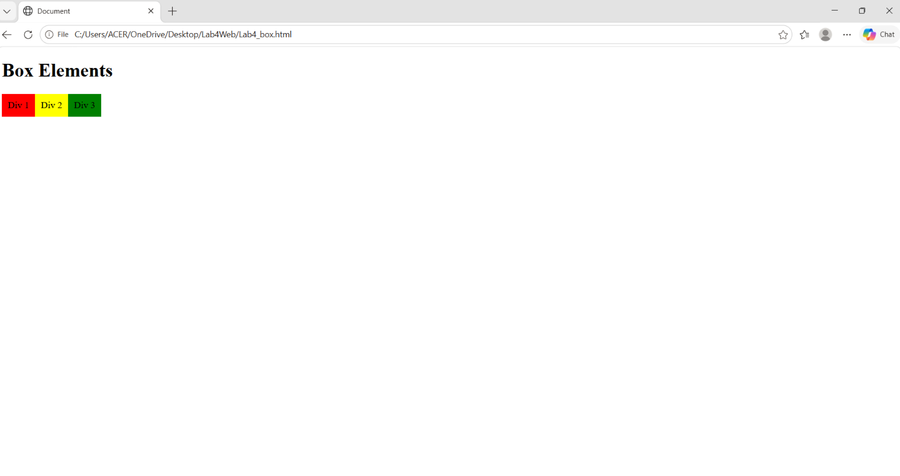
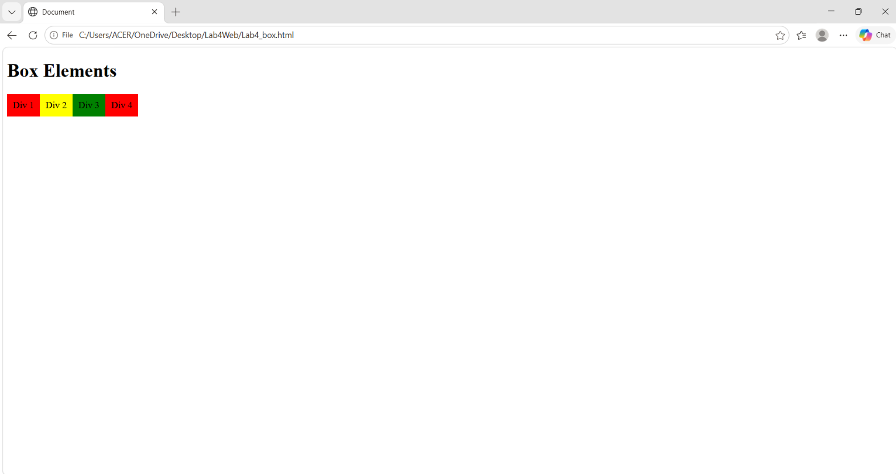
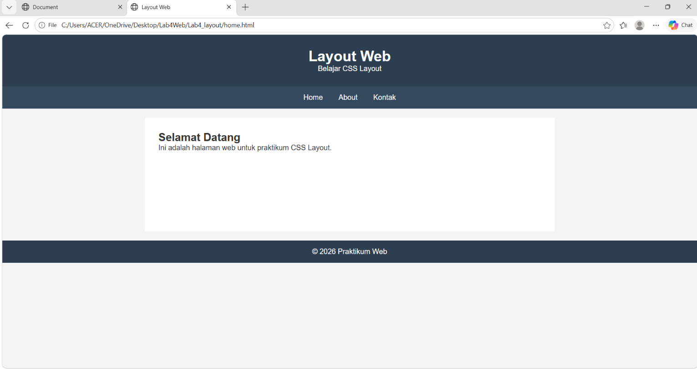
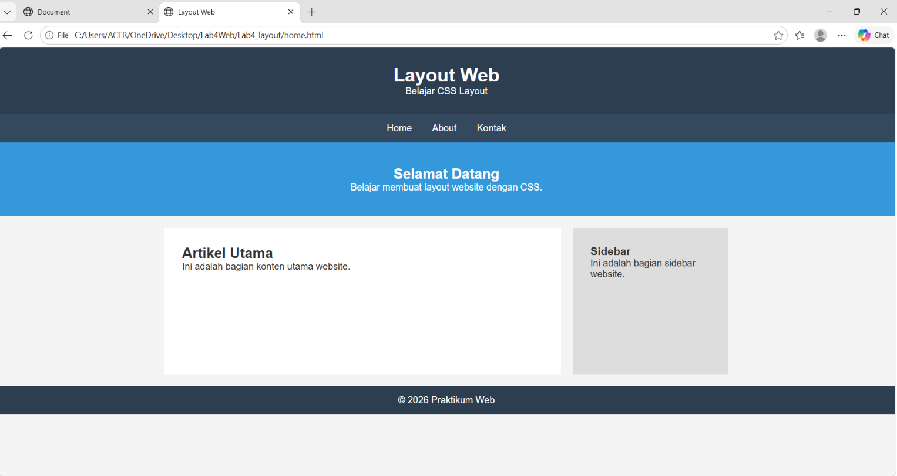
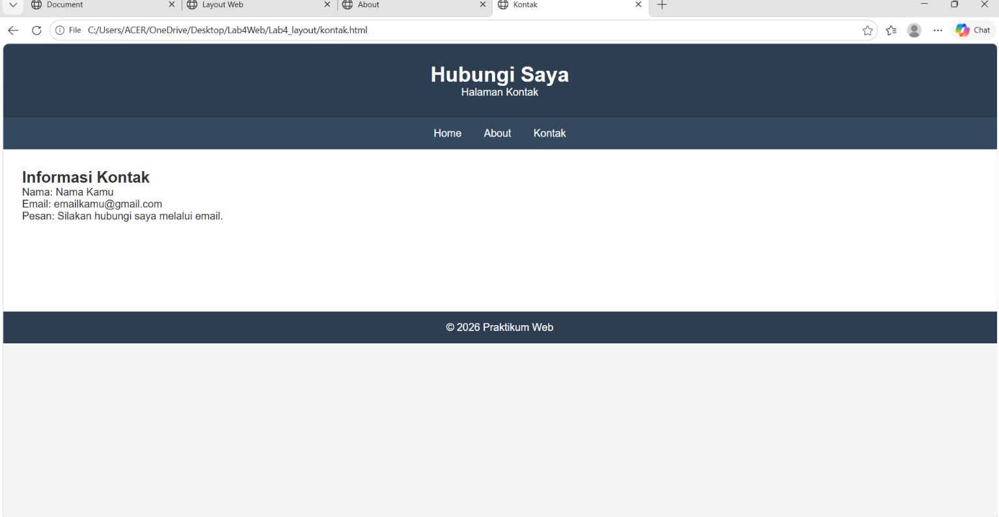
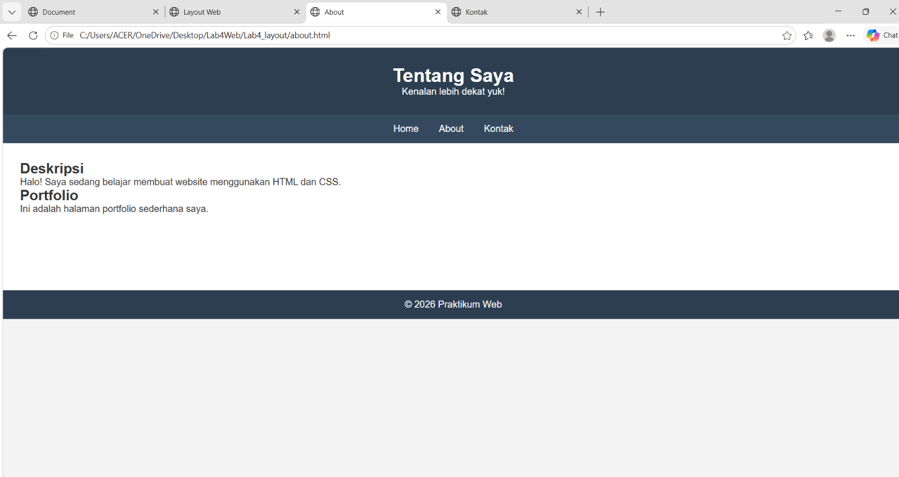
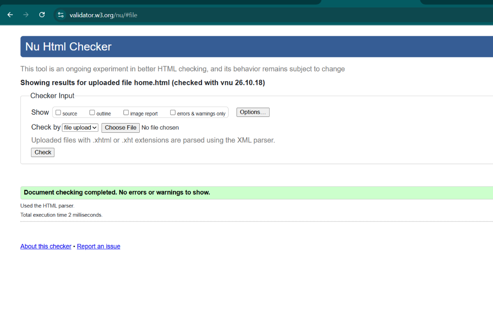

# Praktikum 4 - CSS Layout

Nama: Amanda Eka Putri Sri Lestari

## Deskripsi
Project ini dibuat untuk latihan membuat layout website menggunakan HTML dan CSS.

# Praktikum 4 - CSS Layout

## 1. Membuat Layout Website
Membuat halaman website menggunakan HTML dan CSS. Halaman ini terdiri dari header, menu navigasi, konten utama, sidebar, dan footer.

## 2. Membuat Halaman About
Halaman About berisi deskripsi singkat dan portfolio.

## 3. Membuat Halaman Contact
Halaman Contact berisi informasi nama, email, dan pesan.

## 4. Mengatur Tampilan dengan CSS
CSS digunakan untuk mengatur warna, ukuran, jarak, dan posisi elemen agar tampilan website lebih rapi.

## 5. Hasil Praktikum
Screenshot hasil website 

## 6. Hasil Vlidasi

